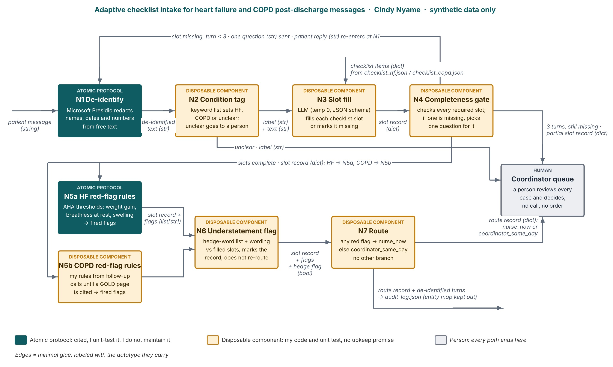

# post-discharge-intake-agent

This repository holds unit tests for the **symptom flagging** step of my final project, an adaptive intake agent that reads messages from heart failure and COPD patients after hospital discharge. The step uses the ConText component of [medspaCy](https://github.com/medspacy/medspacy) to decide whether each symptom a patient mentions is present, denied, uncertain, historical, hypothetical, or about a family member. medspaCy is the citable source; the tests check the exact calls my workflow makes.

## Wire diagram

ConText (medspaCy) sits early in the intake path: it takes the patient message as a string and returns a list of symptom mentions with negation and other flags, which the condition-tag and slot-fill steps then use.

De-identification (Presidio) is no longer on the main path; it runs only when a transcript leaves the care team. (The diagram below is my Session 5 version, which still shows it first.)



## Contract

| | Type | Description |
|---|---|---|
| **Input** | `str` | One patient message, English free text |
| **Output** | `list[dict]` | One dict per symptom mention, with `text`, `label`, `is_negated`, `is_uncertain`, `is_historical`, `is_hypothetical`, `is_family`. Empty list if no symptom terms are found. |

## Tested versions

- medspacy 1.3.1
- spacy 3.8.16
- pytest 8.3.4
- Python 3.13

## Setup and running the tests

In Google Colab: upload `test_medspacy_context.py` and `requirements.txt`, then run

```bash
!pip install -q -r requirements.txt
!python -m pytest -v test_medspacy_context.py
```

On your own computer:

```bash
python -m venv .venv
source .venv/bin/activate        # Windows: .venv\Scripts\activate
pip install -r requirements.txt
pytest -v
```

Expected result: **14 passed, 6 xfailed**.

## What the tests cover

- **Typical inputs:** denied symptoms are flagged as negated and reported symptoms are not; symptoms about a family member, uncertain, historical and hypothetical symptoms are flagged; negation stops at "but" and at the end of a sentence.
- **Edge cases:** an empty message or a message with no symptoms returns an empty list; matching ignores capital letters; very long messages are handled.
- **Invalid inputs:** non-string input such as `None` or a number raises an error.

## Known limitations

These are marked `xfail(strict=True)`, so the suite fails loudly if a future medspaCy release changes the behavior:

- "No improvement in my shortness of breath" is read as a denied symptom.
- "Not only chest pain..." is read as a denied symptom.
- "Chest pain? No." is not read as denied, because the two sentences are split.
- "I'm not sure if..." is read as negated instead of uncertain.
- "I might have some swelling" is not read as uncertain.
- Lay wording such as "short of breath" is not matched, because the symptom term is "shortness of breath". That is a gap in my term list, not in ConText.

## Data

All test messages are invented. No patient data is used anywhere in this repository.
