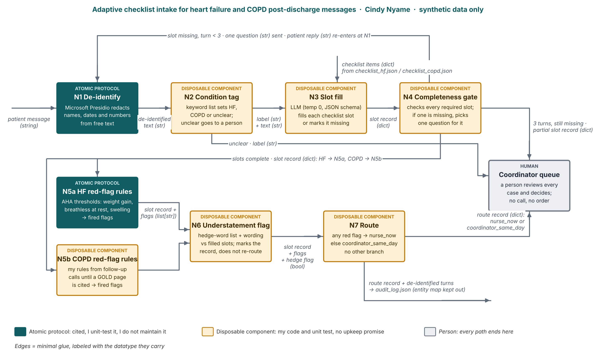

# post-discharge-intake-agent

[](https://github.com/cindynyame37-afk/post-discharge-intake-agent/actions/workflows/tests.yml)

An adaptive checklist intake agent for messages from heart failure (HF) and COPD patients after hospital discharge. It reads the patient's message, fills a condition-specific checklist, asks one follow-up question at a time (up to three turns) until the checklist is complete, applies red-flag rules, and routes every case to a person: `nurse_now`, `coordinator_same_day`, or the coordinator queue. It never calls a patient or places an order.

**Status: rough draft (Session 11).** Runs end to end on synthetic data only. Not for use with real patients.

## Run it

```bash
pip install -r requirements.txt
python run_intake.py synthetic/hf_understated.json      # one case
python run_intake.py synthetic/*.json                   # all synthetic cases
pytest -v                                               # all unit tests
```

Each run prints the route record and appends it to `outputs/audit_log.json` (git-ignored), with the transcript de-identified by Presidio.

**Slot fill (N3)** uses an offline rule-based stand-in by default, so the tests need no API key. To use Gemini instead, set `USE_LLM=1` and `GEMINI_API_KEY` (and optionally `GEMINI_MODEL`) as environment variables. Never put a key in the code or the repository. The Gemini path has not yet been run in the tests.

## Files

| File | What it is |
|---|---|
| `run_intake.py` | The whole workflow; one section per wire-diagram node |
| `data/checklist_hf.json`, `data/checklist_copd.json` | Checklist slots and the question asked for each |
| `synthetic/*.json` | Invented cases, including matched direct vs understated pairs |
| `test_workflow.py` | Unit tests for every node plus end-to-end runs |
| `test_medspacy_context.py` | Unit tests for the medspaCy ConText atomic protocol |

## Components

| Node | Type | What it does |
|---|---|---|
| ConText (medspaCy 1.3.1) | Atomic protocol | Flags each symptom as present, denied, uncertain, historical, hypothetical or family |
| N2 Condition tag | Disposable | Keyword list sets HF, COPD or unclear; unclear goes to a person |
| N3 Slot fill | Disposable | Fills checklist slots (offline rules, or Gemini at temperature 0); unsure answers stay empty |
| Pydantic 2.13.5 | Atomic protocol | Checks the slot record against the checklist schema before it is used |
| N4 Completeness gate | Disposable | Lists empty required slots and picks one question; after 3 turns, sends the partial record to a person |
| N5a HF red-flag rules | Disposable | AHA warning signs: weight gain of 3 lb in a day or 5 lb in a week, breathless at rest, new swelling, chest pain, not taking the water pill |
| N5b COPD red-flag rules | Disposable | My provisional rules (breathless at rest, mMRC 4, sputum change with fever, rescue inhaler 4+ times a day, chest pain), pending a GOLD citation |
| N6 Understatement flag | Disposable | Marks hedged wording on a case that fired a red flag; does not re-route |
| N7 Route | Disposable | Any red flag goes to `nurse_now`, otherwise `coordinator_same_day` |
| Presidio 2.2.366 | Atomic protocol | De-identifies the transcript only when it leaves the care team (audit log) |

Expected test result: **41 passed, 7 xfailed**.

---

# Earlier work: ConText unit tests

The section below documents the **symptom flagging** step on its own.

## Wire diagram

ConText (medspaCy) sits early in the intake path: it takes the patient message as a string and returns a list of symptom mentions with negation and other flags, which the condition-tag and slot-fill steps then use.

De-identification (Presidio) is no longer on the main path; it runs only when a transcript leaves the care team. (The diagram below is my Session 5 version, which still shows it first.)



## Contract

| | Type | Description |
|---|---|---|
| **Input** | `str` | One patient message, English free text |
| **Output** | `list[dict]` | One dict per symptom mention, with `text`, `label`, `is_negated`, `is_uncertain`, `is_historical`, `is_hypothetical`, `is_family`. Empty list if no symptom terms are found. |

## Tested versions

- medspacy 1.3.1
- spacy 3.8.16
- pytest 8.3.4
- Python 3.13

## Setup and running the tests

In Google Colab: upload `test_medspacy_context.py` and `requirements.txt`, then run

```bash
!pip install -q -r requirements.txt
!python -m pytest -v test_medspacy_context.py
```

On your own computer:

```bash
python -m venv .venv
source .venv/bin/activate        # Windows: .venv\Scripts\activate
pip install -r requirements.txt
pytest -v
```

Expected result for this file alone: **15 passed, 6 xfailed**.

## What the tests cover

- **Typical inputs:** denied symptoms are flagged as negated and reported symptoms are not; symptoms about a family member, uncertain, historical and hypothetical symptoms are flagged; negation stops at "but" and at the end of a sentence; one "no" covers a list of symptoms.
- **Edge cases:** an empty message or a message with no symptoms returns an empty list; matching ignores capital letters; very long messages are handled.
- **Invalid inputs:** non-string input such as `None` or a number raises an error.

## Known limitations

These are marked `xfail(strict=True)`, so the suite fails loudly if a future medspaCy release changes the behavior:

- "No improvement in my shortness of breath" is read as a denied symptom.
- "Not only chest pain..." is read as a denied symptom.
- "Chest pain? No." is not read as denied, because the two sentences are split.
- "I'm not sure if..." is read as negated instead of uncertain.
- "I might have some swelling" is not read as uncertain.
- In the full workflow, "No improvement in my shortness of breath" therefore misses the breathless-at-rest red flag (`test_workflow.py`, xfail).
- Lay wording such as "short of breath" is not matched, because the symptom term is "shortness of breath". That is a gap in my term list, not in ConText.

## Data

All test messages are invented. No patient data is used anywhere in this repository.
